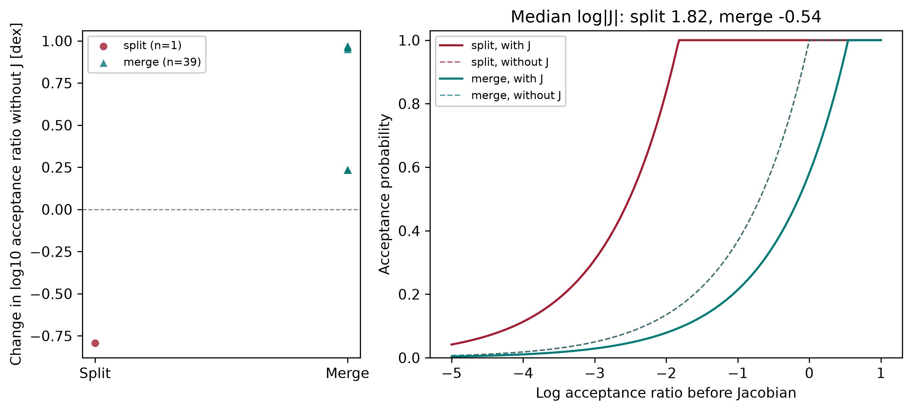
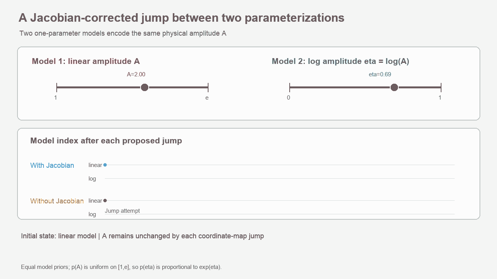
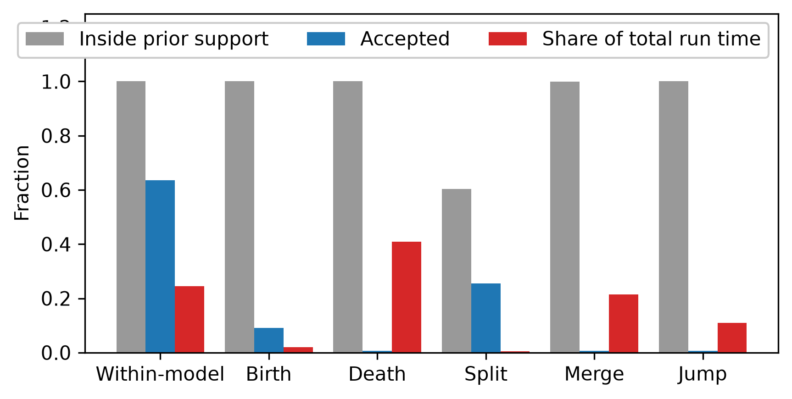
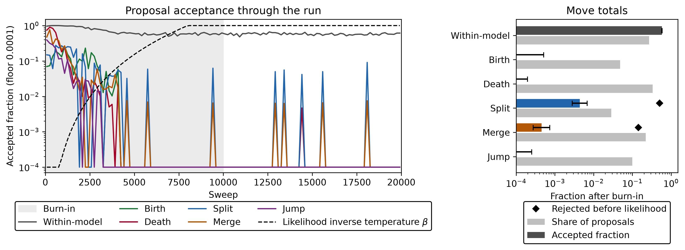
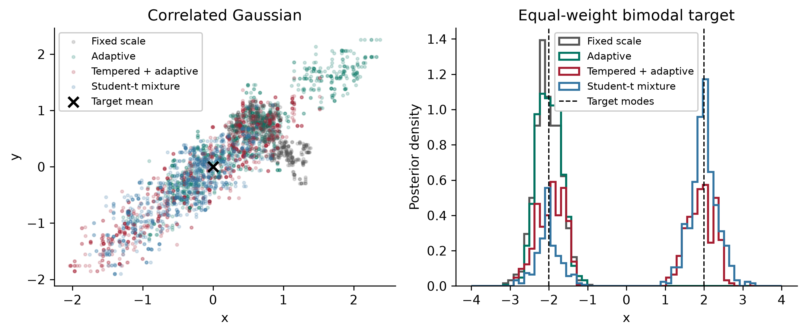
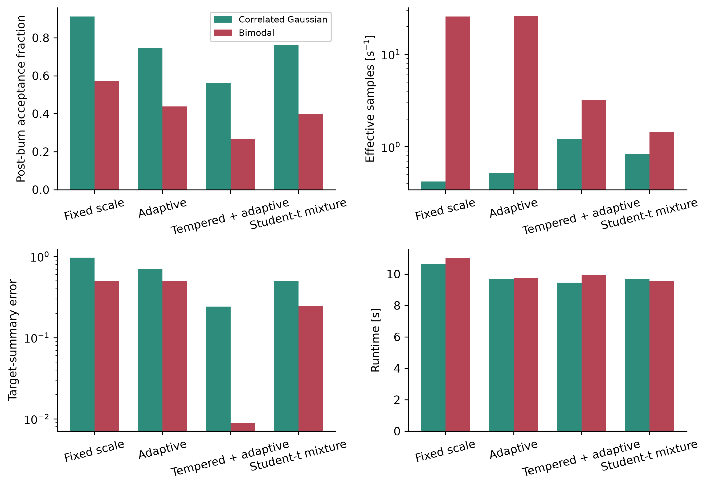
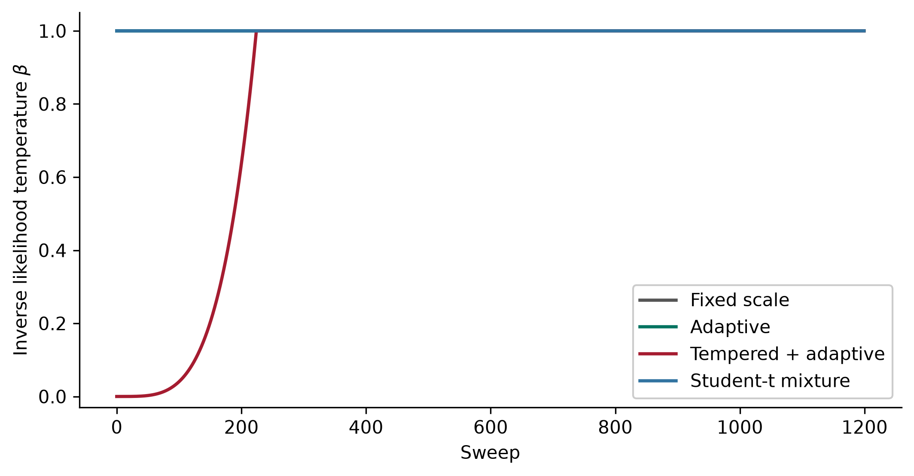
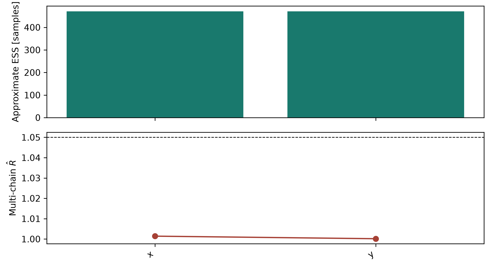
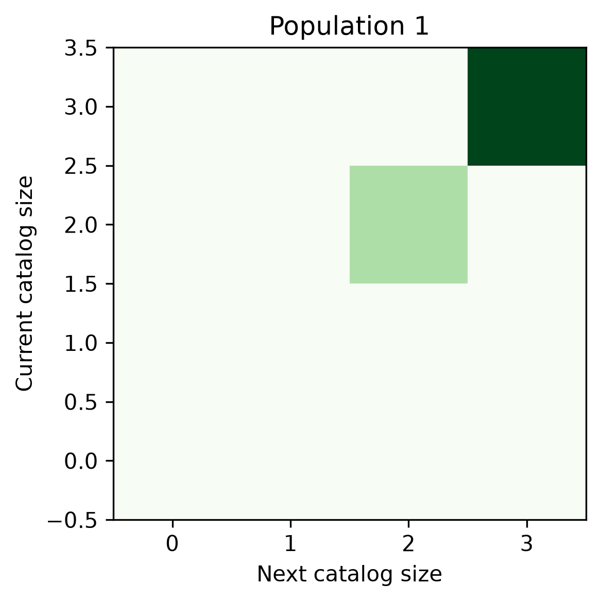

Sampling, proposals, and convergence
====================================

PCAT uses one Metropolis-Hastings sampler for inference within one model or over
a metamodel. A sweep selects a proposal, evaluates its candidate state, and
accepts or rejects that candidate. The realized proposal type,
acceptance probability, and accept/reject result are recorded for every sweep.

Proposal types
--------------

.. list-table:: PCAT proposal families
   :header-rows: 1
   :widths: 18 38 44

   * - Type
     - State change
     - Main settings
   * - Within-model
     - Updates existing parameters without changing the number of elements.
      It is the only proposal used by default when inference stays within one
      model.
     - ``stdvpropbase`` and ``stdvpropelemfire`` set unit-coordinate step
       scales. ``booladaptstdp=True`` adapts these scales during burn-in.
       ``probdemc`` mixes in differential-evolution steps and ``probstud``
       mixes in factorized Student-t(5) steps. Both default to zero, and their
       probabilities must sum to at most one.
   * - Birth
     - Adds an element drawn from its prior, a data-informed proposal, or the
       optional conditional neural density.
     - ``probtran`` enables transdimensional proposals. ``factpriodoff``
       changes the prior penalty for added dimensions.
   * - Death
     - Removes one existing element.
     - Selected with birth moves under ``probtran`` and the model-count
       bounds.
   * - Split
     - Replaces an element with two elements when the element model supports
       reversible-jump splitting.
     - ``probspmr`` controls the split/merge share. ``radispmr`` sets the
       scale of the split displacement.
   * - Merge
     - Replaces a pair of elements with one element when the model supports
       reversible-jump merging.
     - Uses the reverse-proposal probability and Jacobian correction of the
       split move.
   * - Jump
     - Redraws one existing element from its prior without changing catalog
       size.
     - ``probjump`` controls the probability of attempting this move when a
       catalog is nonempty.
   * - Differential evolution
     - Proposes a symmetric within-model step from the difference between two
       states in a bounded history.
     - ``probdemc`` enables the move, ``numbdemchist`` sets the history length,
       and ``factdemcgamma`` optionally sets its jump scale.
   * - Correlated block
     - Updates a configured set of fixed-dimensional parameters together.
     - ``probpropblock`` sets its mixture probability.
       ``proposal_correlation`` and ``proposal_blocks`` define its shape, and
       ``factpropblock`` scales its step.

Birth, death, split, and merge moves are available only for supported element
models. Their direction can be restricted by the model's minimum and maximum
element counts. If split or merge is unsupported, set ``probspmr=0``. At a
catalog boundary, PCAT selects only moves that can leave the current state.

Neural element proposals
------------------------

Install the optional backend with ``python -m pip install 'pcat[neural]'``.
Fit ``NeuralElementProposal`` on simulated observation-feature vectors and
element parameters transformed into the unit-prior cube. Each row must be one
training pair. The proposal is a conditional mixture of truncated Gaussian
density components plus a uniform component controlled by
``uniform_fraction``. The uniform component gives every unit-cube element
positive proposal density. The model is fitted before sampling and remains
frozen during each chain.

.. code-block:: python

   from pcat import NeuralElementProposal, sampling

   proposal = NeuralElementProposal.fit(
     condition_features,
     simulated_unit_elements,
     uniform_fraction=0.05,
     seed=12,
   )
   proposal.save("analysis/neural_birth.pt")
   proposal = NeuralElementProposal.load("analysis/neural_birth.pt")
   result = sampling.sample(
     **run_configuration,
     neural_proposal_features=features_for_this_run,
     probtran=0.4,
     **proposal.callbacks(),
   )

The run feature vector must use the same fixed-length representation and
preprocessing as the training conditions. ``callbacks()`` supplies both the
draw and normalized log-density functions required by PCAT. The Metropolis--
Hastings correction includes that density for births, deaths, and prior-redraw
jumps, along with the catalog-count prior, move-selection probabilities, and
any Jacobian. The neural proposal does not replace the catalog sampler. Validate the fitted
density and posterior recovery on held-out simulations before interpreting
efficiency comparisons.

For a proposal that depends on the live catalog, use ``state_callbacks()`` and
provide a feature builder that combines the observation features with summaries
of the supplied immutable ``ProposalContext``. Training conditions must be
computed from simulated catalog states using that same feature builder. PCAT
evaluates a birth density at the current catalog and a death's reverse-birth
density at the catalog after removing the proposed element. Existing
``callbacks()`` retain their data-only behavior.

The feature builder must be a module-level, picklable callable because PCAT
serializes run configurations for worker chains. For example, if the run
configuration contains a fixed observation feature vector, the builder can
append the current element counts:

.. code-block:: python

   import numpy as np

   def retr_proposal_condition(gdat, context):
     return np.concatenate((
       gdat.neural_proposal_features,
       np.asarray(context.element_counts, dtype=float),
     ))

   state_callbacks = proposal.state_callbacks(retr_proposal_condition)

For prior-redraw jumps, the selected element is omitted from the context for
both the proposed and reverse density evaluations. The default radial-velocity
efficiency benchmark uses the data-only callbacks. Its short state-conditioned
smoke run is described below.

When using ``retr_dictpcatrvel`` to build a radial-velocity configuration, set
``boolmakepropelem=False`` before adding state-conditioned callbacks. That
helper otherwise installs its data-only matched-filter proposal by default.

A flat-likelihood regression uses a normalized count-conditioned proposal and
checks recovery of the configured uniform count prior over zero to three
elements. This is a controlled sampler-correctness test, not evidence of
efficiency or calibration across astronomical models. A separate 400-sweep
state-conditioned smoke run on one held-out scene failed count-posterior
agreement and is only evidence that the benchmark path executes. A completed
three-scene run with 12,000 sweeps per chain also failed the pre-specified gain
check. State-conditioned count ESS per likelihood call was 0.029 times prior
(95% scene-bootstrap interval 0.029 to 0.60) and 1.20 times data-informed
(0.11 to 1.53). Median count-posterior total variation was 0.44 from prior and
0.57 from data-informed. Neural log-likelihood R-hat was 1.35, 1.00, and 2.32
across the scenes, exceeding 1.1 in two. This is evidence against a gain for
this training setup, not a universal result. Run additional state-conditioned comparisons
with a fresh ID using
``python examples/neural_proposal_efficiency/neural_proposal_efficiency.py
--proposal-conditioning state --run-id state_conditioned_efficiency_v1``.
The experimental ``--state-feature-mode residual`` instead computes the
periodogram from the velocity residual after subtracting the catalog model
represented in the current context. Its one-scene smoke run checks execution
only; no performance result is established for this mode.

Acceptance probability
----------------------

For a current state ``x`` and candidate ``x'``, the log Metropolis-Hastings
ratio is

.. math::

   \log r = \log \pi(x'\mid d) - \log \pi(x\mid d)
            + \log q(x\mid x') - \log q(x'\mid x)
            + \log |J|,

where ``pi`` is the posterior density, ``q`` is the proposal density, and
``J`` is the reversible-jump Jacobian. PCAT accepts with probability

.. math::

   \alpha = \min(1, \exp(\log r)).

The reflected within-model Gaussian random walk, differential-evolution
proposal, and factorized Student-t proposal are symmetric in unit-prior
coordinates, so their proposal-density ratio is one and their Jacobian is one.
The Student-t(5) increments are scaled to have the same variance as the
Gaussian step. They are independent by coordinate, including when a correlated
block is selected. Birth and death moves include model-count and
auxiliary-parameter corrections. Split and merge moves include reverse-move
probabilities and the split Jacobian. For a prior-redraw jump, the element
prior cancels its proposal density, leaving the likelihood change plus any
Hastings correction for a data-informed draw.

.. list-table:: Proposal-specific terms added to the posterior change
   :header-rows: 1
   :widths: 24 76

   * - Move
     - Additional log-ratio terms
   * - Within-model Gaussian, differential-evolution, Student-t, or correlated block
     - None for these symmetric proposals. Their log proposal ratio and
       Jacobian are zero.
   * - Birth or death
     - Model-count and move-selection corrections, the auxiliary element draw density when it does not cancel against the prior, and any configured dimension-prior offset such as ``factpriodoff``.
   * - Split
     - Reverse merge-selection probability, auxiliary-variable density, and the positive split Jacobian. For the amplitude-fraction split below, ``log|J| = log(F)``.
   * - Merge
     - Reverse split-selection probability, reverse auxiliary-variable density, and the negative split Jacobian, ``-log(F)`` for the transform below.
   * - Prior-redraw jump
     - The element prior cancels its proposal density. The remaining target
       change is the likelihood ratio. A data-informed draw adds its Hastings
       correction.

The final state stores per-sweep proposal IDs in ``listpostindxproptype``,
accept/reject flags in ``listpostboolpropaccp``, and acceptance probabilities in
``listpostaccpprob``. The unclipped log acceptance ratio is stored in
``listpostaccplprb`` so it remains available when exponentiation underflows.
Final processing also computes ``accpwith``, ``accpbrth``,
``accpdeth``, ``accpsplt``, ``accpmerg``, and ``accpjump`` from attempted moves.
An acceptance fraction is accepted attempts divided by attempts of that type.
Use it to tune the sampler, not as a target to maximize. Very small steps can have
high acceptance but explore the posterior slowly. Large steps can have low
acceptance and waste evaluations.

The ``proposal_state_animation`` example uses the native split/merge moves to
show the Jacobian correction. Splitting parent amplitude ``F`` into ``r F`` and
``(1-r) F`` contributes ``log|J| = log(F)``. Merging applies its negative. The
figure compares each valid proposal's acceptance probability while holding
every other term fixed and removing only ``log|J|``. It uses the same proposals.

  The left panel shows the log-acceptance-ratio shift for each valid proposal.
  The right panel shows the acceptance curve with the median Jacobian from the
  run and its no-Jacobian counterfactual.

The same example also animates jumps between equivalent one-parameter models
using linear amplitude ``A`` and log amplitude ``eta = log(A)``. The target
density ratio contributes ``A`` in the forward direction, while the Jacobian
contributes ``1/A``. Including both gives unit acceptance in either direction.
Without the Jacobian, reverse jumps accept with probability ``1/A``, producing
biased occupancy of the two parameterizations.

   Proposal acceptance and evaluation cost in the simulated Voigt-line
   profiling example. The values depend on the model, prior, data, and tuning.

The proposal ledger illustrates the observed acceptance of each move type
through burn-in and sampling. Within-model subproposals such as Student-t and
differential-evolution are pooled under the within-model identifier.

  Acceptance fractions are tuning summaries for diagnosing movement, not
  objectives to maximize.

Tuning proposals
----------------

``probtran`` defaults to ``0.4`` when a variable population is present and
``0`` otherwise. It is the probability of selecting a transdimensional move.
``probspmr`` defaults to half of ``probtran`` and sets the fraction of eligible
transdimensional selections allocated to split and merge. The remaining share
is allocated to birth and death. Split and merge directions are balanced when
both are available, with boundary restrictions taking precedence.
``probjump`` defaults to ``0.1`` when a variable population is present, so
catalog runs propose within-model, birth, death, split, merge, and jump moves
by default. ``probdemc`` and ``probstud`` default to zero and must be enabled
explicitly. Both probabilities default to zero, and their sum must not exceed one.
``probstud`` mixes in independent,
variance-matched Student-t(5) increments for the currently selected
within-model parameters. The heavy tails can help traverse separated modes but
can reduce efficiency on a locally Gaussian target. In a seeded 8,000-sweep
comparison on the bimodal example, the Student-t mixture increased mode switches
from 5 to 17 and ESS per second from 0.2 to 1.8, while on the correlated
Gaussian it reduced ESS per second from 3.9 to 2.2. These short-run results are
problem-specific, not a universal ranking.
``booladaptstdp`` defaults to ``True``: within-model step sizes adapt toward
their target acceptance during burn-in only, so the retained chain is an
ordinary Metropolis-Hastings chain. The :func:`pcat.plotting.plot_proposal_ledger`
view reports how often each move is proposed and accepted.

For an existing model configuration, proposal controls can be added before
calling the sampler:

.. code-block:: python

   configuration.update(
       probtran=0.7,
       probspmr=0.4,
       probjump=0.1,
       probdemc=0.1,
      probstud=0.2,
       numbdemchist=1000,
       booladaptstdp=True,
   )
   result = pcat.sampling.sample(**configuration)

Start with the model's native proposal scales and inspect acceptance by move
type, trace behavior, model-count transitions, residuals, and effective sample
sizes. Adjust ``stdvpropbase`` or ``stdvpropelemfire`` when within-model moves
are too large or too small. Set ``probpropblock`` only when correlated blocks
and a matching ``proposal_correlation`` are configured. ``probdemc`` uses at
least ten history states before it can propose. Its default history length is
1,000, and its default scale is ``2.38 / sqrt(2 d)`` for a ``d``-parameter
update.

Burn-in and scale adaptation
----------------------------

``numbburn`` is the number of initial sweeps excluded from retained samples. If
it is omitted, PCAT uses ten percent of ``numbswep``. Set ``numbsamp`` or
``factthin`` to control the number of retained samples after burn-in.

``booladaptstdp=True`` adapts within-model proposal scales during burn-in only.
The sampler uses a target acceptance of 0.44 for one-dimensional updates and
0.234 for multivariate updates. Adaptation stops once burn-in ends. Report the
burn-in length and proposal settings with scientific results, and check that
posterior summaries are stable to a longer run or a different seed.

Set ``boolburntmpr=True`` to temper the likelihood during the first
``factburntmpr`` fraction of burn-in. The default fraction is 0.75. At tempered
sweep ``s`` out of ``N`` tempered sweeps, PCAT uses

.. math::

  \beta_s = \left(\frac{s + 1}{N}\right)^4

and evaluates the target as ``log_prior + beta_s * log_likelihood``. The prior
is not tempered. ``beta_s`` is stored for every sweep in
``listpostfacttmpr`` and equals one before retained sampling begins. Tempering
can help a chain cross likelihood barriers during burn-in, but it can reduce
local effective sample size and does not guarantee discovery of every mode.

``typeopti="hess"`` estimates local finite-difference curvature to initialize
proposal scales. It does not take gradient steps or optimize the initial state.
PCAT currently offers no gradient descent burn-in mode.

The :doc:`examples` page links ``burn_in_strategies``, which compares fixed,
adaptive, tempered plus adaptive burn-in, and adaptive Student-t within-model
proposals on correlated and bimodal simulated targets. The figures below show
retained states, effective-sample performance, target-summary error, runtime,
and the tempered likelihood schedule. Their results are illustrative and
target-specific.

Automatic convergence monitoring
--------------------------------

By default PCAT stops after repeated convergence checks, subject to the
configured sweep count as a hard maximum. Set ``boolcheckconv=False`` to use a
fixed sweep count. The defaults are ``numbsampconvmin=500`` retained samples before the first check,
``numbsampconvcheck=250`` samples between checks, ``maxmconvrhat=1.01``,
``numbsampconveffc=200``, and ``numbconvpass=2`` consecutive passing checks.
For one worker PCAT estimates R-hat by splitting the chain in half. With several
workers, it calculates convergence across independent worker chains and stops
them together after they all observe the shared stop signal.

If the criterion is not met by ``numbswep``, the run stops at that cap and
records that convergence was not reached.

Convergence is assessed using log posterior, element count, persistent element
parameters, or modeled data pixels when no persistent element parameter is
available. Inspect the values saved in ``gdatfinlpost`` and the convergence
plots. Automatic stopping does not establish that the likelihood, model, or
priors are scientifically adequate.

With posterior plotting enabled, completed runs write separate figures under
``visuals/post/convergence/``. Fixed-parameter figures show per-worker traces,
autocorrelation, approximate effective sample size, and cross-worker R-hat.
For transdimensional populations, the figures show catalog-size traces,
autocorrelation, occupancy, within-worker size transitions, and mixing metrics.
Early-versus-late distributions compare each sampled one-dimensional element
feature without assigning identities to elements across birth or death moves.
The approximate effective sample size uses a bounded autocorrelation window.
Short runs can yield unstable estimates. A single worker has no cross-worker
R-hat, which is shown as unavailable rather than assigned a value.

These figures show examples of the fixed-parameter ESS/R-hat summary and the
catalog-size transitions used to inspect transdimensional mixing.

To create the figures from a saved posterior without rerunning inference, call
``pcat.plotting.plot_posterior_convergence(state, output_directory)`` after
loading ``gdatfinlpost`` with ``pcat.main.readfile``. The figures support
inspection and do not replace checks for multiple modes or model mismatch.

Animations and saved diagnostics
--------------------------------

Set ``makeanim=True`` and ``numbswepplot`` so at least two chain frames are
saved. With frame plotting enabled, PCAT writes the usual posterior animations
from these retained chain states. It also writes ``proposal_activity.gif``,
which shows cumulative proposal attempts and acceptances, and
``proposal_sequence.gif``, which labels each saved state frame with its sweep,
proposal type, and acceptance result. The sequence animation uses saved frame
intervals rather than every sweep. A rejected proposal remains represented by
the retained chain state.

Set ``boolmakeanimprop=True`` to additionally write one candidate frame for
every sweep of worker zero. PCAT renders the frame after evaluating the
candidate and acceptance probability but before an accepted candidate replaces
the current state. ``proposal_candidates.gif`` therefore shows accepted and
rejected candidates, including moves outside prior support. Each frame compares
current and candidate predictions and unit-prior coordinates and reports the
proposal type, acceptance probability, decision, log posterior values,
proposal-density ratio, and Jacobian.

Candidate frames are proposal diagnostics, not posterior samples. The option is
off by default because it performs plotting and writes one PNG per sweep. Its
runtime and storage scale linearly with ``numbswep``. Use short runs for proposal
inspection, then disable it for production inference. The
``proposal_state_animation`` example produces both retained-state and
every-candidate animations from the same simulated Voigt-line run.

The proposal-profiling example includes a visual comparison of acceptance and
cost above and writes proposal activity with its run. See :doc:`outputs` for
the output directory and persisted diagnostics, and :doc:`capabilities` for
the maintained model families.